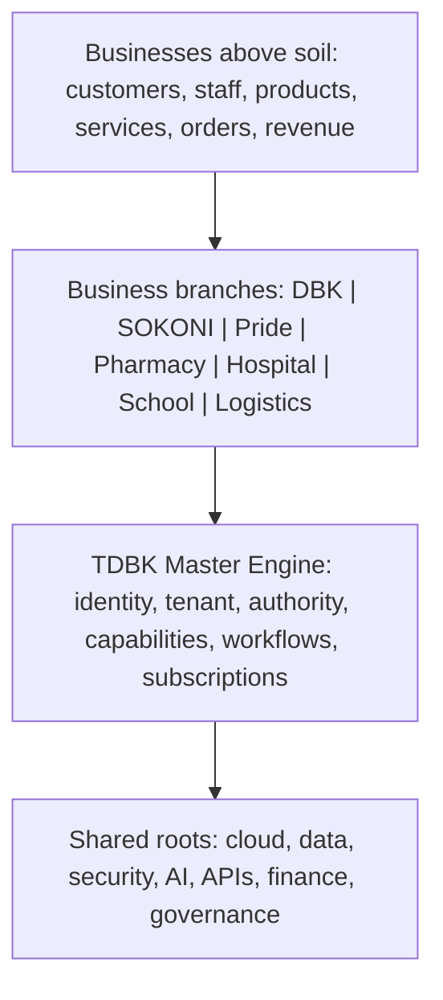

# TDBK End-to-End Junction & Dependency Map
**Audit date:** 2026-11-17  
**Working branch:** `audit/stage-1-master-unification-register`  
**Status:** IN PROGRESS — evidence-backed partial trace, not a production certification.

## Purpose
Trace TDBK as the whole tree: businesses and customers operate above the soil; TDBK provides the shared digital and operational foundation beneath them. The Master Engine is the coordinating trunk, not the whole organisation.

Each junction is assessed across: source/producer, consumer, authority, contract, tenant/security boundary, lifecycle/failure handling, verification evidence and live status.

### Status vocabulary
- **VERIFIED — SOURCE:** the named source file or contract was inspected; this does not prove production execution.
- **PARTIAL:** some implementation or contract evidence exists, but a required boundary or test is incomplete.
- **BLOCKED:** a documented release gate prevents safe activation.
- **UNKNOWN:** source or runtime evidence has not yet been inspected.
- **NOT VERIFIED LIVE:** no authenticated production test was performed in this audit.

## 1. Whole-tree dependency model

The direction of value and control is bidirectional: the foundation supplies capabilities and policy; business operations return events, state and commercial outcomes. A branch remains responsible for its domain operations while consuming shared authority through explicit contracts.

## 2. Junction register

| ID | Junction | Source / consumer | Evidence inspected | Assessment |
|---|---|---|---|---|
| J01 | TDBK authority → Master Engine | Master identity/authority → all platform services | `src/kernel/types.ts` defines Principal, TenantContext, BranchContext, SecurityContext and AuditEvent. DBK contract declares Engine authority over identity, tenancy, DNA, capabilities, entitlements, permissions, transactions, payments, receipts, workflows, events, AI, connectors, audit and security. | **PARTIAL — SOURCE VERIFIED.** Contract authority is clear; complete enforcement across every service and runtime is not verified. |
| J02 | Master Engine → tenant/branch context | Security context → tenant-scoped services | `Principal` carries tenantId, branchId, roles, permissions and tokenSource; `SecurityContext` carries tenant/branch context and request/correlation IDs. | **PARTIAL.** Type contract exists; adversarial cross-tenant and branch-boundary test evidence still required. |
| J03 | Master Engine → connector integrations | Connection Hub → provider bridge adapters | `src/orchestration/bridge/connectionHub.ts` resolves connection records using tenant context, rejects missing tenant context, checks bridge definition and uses Firestore connection repository, RBAC and audit services. | **PARTIAL.** Tenant-aware resolution exists in source; provider credentials, real provider calls and live health are not verified. |
| J04 | Master Engine → workflow/event execution | Workflow Engine → repositories, outbox, event bus, step handlers | `src/orchestration/workflow/engine.ts` creates tenant-bound workflows, correlation IDs, retry policies, compensation references, audit events and lifecycle envelopes. Persistent creation writes workflow/outbox records before publication. | **PARTIAL.** Durable path is present in source; worker delivery, restart recovery, idempotency and production persistence need execution tests. |
| J05 | Master Engine → DBK experience | Experience Projection → workspace manager → DBK UI | `src/platform/projection/experienceProjection.ts` checks master or tenant access, compiles workspace and projects identity, sector, status, subscription tier, branches, capabilities and terminology. `docs/DBK_WEBSITE_EXPERIENCE_CONTRACT.md` says DBK is an experience layer, not a second authority. | **PARTIAL.** Projection and authority contract exist; deployed DBK consumption and public-safe projection are not verified. |
| J06 | Master Engine → subscription/licensing | Subscription router/service → DBK registry, subscription repository, M-Pesa bridge | `src/platform/subscription/subscriptionRouter.ts` creates security context, checks DBK access, initiates M-Pesa STK via Connection Hub and records pending provider reference/status. | **PARTIAL / BLOCKED FOR LIVE ACTIVATION.** Router path exists; provider-confirmed payment-to-ledger activation is gated. |
| J07 | Payment provider → financial truth | Daraja adapter/status query → tenant transaction → ledger | `docs/audits/MPESA_PRODUCTION_CALLBACK_VERIFICATION_GATE_2026-11-14.md` states production callbacks fail closed because callback origin cannot be authenticated; Transaction Status Query and authenticated asynchronous result ingress are not yet implemented. | **BLOCKED.** Do not treat callback payloads or STK initiation as proof of payment. Sandbox/UAT and reconciliation path required. |
| J08 | Business catalogue → SOKONI | Seller/product authority → public listing/discovery | DBK contract says public organisation projection and SOKONI handoff require MASTER REVIEW; it records no concrete public-profile/SOKONI projection contract found at its inspection date. | **UNKNOWN / MASTER REVIEW REQUIRED.** Product/seller authority, publication rules and API/event contract must be traced in SOKONI and branch repositories. |
| J09 | SOKONI → advertising → customer | Approved listing → campaign asset → enquiry/order | No source evidence inspected in this pass for the end-to-end campaign-to-listing-to-conversion contract. | **UNKNOWN.** Must prove ads use approved authoritative product data and track enquiries/orders back to the seller/listing. |
| J10 | Order → inventory → delivery | Order service ↔ stock reservation ↔ fulfilment | No shared cross-branch contract inspected in this pass. | **UNKNOWN.** Need reservation semantics, lifecycle transitions, cancellation/reversal, delivery proof and reconciliation. |
| J11 | AI workforce → staff/control panel | Agent orchestration → duty assignment → execution/audit | Initial baseline ledger records agent runtime, role catalogue, team routing and Firestore execution repositories; deterministic routing metadata is not proof of specialist execution. | **PARTIAL / NOT VERIFIED LIVE.** Inspect durable runs, permissions, approval gates, retry/recovery and staff duty ownership. |
| J12 | Business branch → shared platform | Pride, pharmacy, hospital, school and logistics systems → Engine contracts | Seven repositories were discovered in the baseline register; branch source-to-engine API/event and tenant identity propagation have not yet been fully inspected. | **UNKNOWN by branch.** Do not merge, retire or assume a common backend until domain/data/security/deployment comparisons are complete. |

## 3. Vertical journey traces

### A. Tenant onboarding → operating workspace
1. User authenticates and supplies target business identity.
2. Security context resolves principal, tenant and branch.
3. Master authority/registry validates ownership and tenant access.
4. Business DNA/blueprint and capability eligibility are resolved.
5. Provisioning creates or activates the business workspace.
6. Entitlements/subscription determine enabled capabilities.
7. Experience Projection supplies the DBK client with authoritative workspace state.

**Observed evidence:** kernel context types, DBK authority contract, experience projection, subscription router.  
**Still to prove:** full provisioning sequence, authoritative DNA/blueprint persistence, entitlement enforcement in every capability, cross-tenant denial tests and deployed DBK end-to-end journey.

### B. Seller/product → SOKONI → order → payment
Seller identity → product record → seller-approved publication → SOKONI discovery → advert/campaign → customer enquiry/order → stock reservation → fulfilment → provider-confirmed payment → ledger/receipt → seller reporting.

**Current assessment:** the intended journey is defined, but the catalogue/SOKONI/advertising/order/inventory joints remain **UNKNOWN** in this source pass. Payment settlement is **BLOCKED** for live M-Pesa until provider query/reconciliation is implemented and tested. Do not publish invented prices, specs or stock.

### C. Pride Industries operating journey
Configurable product/variant/price → POS or customer order → stock allocation → delivery/return/container lifecycle → payment verification → ledger/invoice/receipt → management reporting.

**Current assessment:** Pride repository was inventoried previously, but its current source files, storage durability, order lifecycle, WhatsApp and payment integration have not yet been inspected in this junction pass. Mark **UNKNOWN / NOT VERIFIED LIVE** until source and client workflow tests are collected.

### D. Pharmacy operating journey
Tenant/user → medicine catalogue and batch records → prescription/dispensing → FEFO and stock movement → sale/payment → audit/reporting.

**Current assessment:** two pharmacy repositories exist. Canonical ownership, data model, regulatory workflow, FEFO enforcement, tenant isolation and live deployments remain to be compared. No consolidation decision is made.

## 4. Critical invariants at every junction
1. One authoritative owner for each business record; projections and caches are not competing truth.
2. Every tenant-scoped command derives tenant identity from trusted security context, never an untrusted request-body tenant selector.
3. Branch permissions are evaluated independently of tenant membership.
4. Every cross-service event carries tenant, branch (where applicable), event type/version, correlation and causation identity.
5. External side effects use durable outbox/idempotency/retry/compensation patterns where applicable.
6. A payment is not financially true until provider-confirmed and reconciled to the correct tenant, amount, currency and transaction.
7. Customer-facing success is shown only after durable persistence or confirmed provider outcome.
8. A business branch can remain independently deployable without creating a second master identity, entitlement or ledger authority.
9. Production readiness requires deployment, monitoring, backup/restore, security and end-to-end evidence—not source code or README claims alone.

## 5. Priority evidence collection

| Priority | Evidence to collect | Why it matters |
|---|---|---|
| P0 | Tenant/branch adversarial tests; security context creation; Firestore rules | Prevent cross-tenant disclosure or mutation. |
| P0 | M-Pesa Transaction Status Query + authenticated result ingress + ledger reconciliation tests | Prevent forged or misattributed financial settlement. |
| P0 | Pride current persistence/deployment and order-to-delivery client acceptance | Protect active client delivery and data durability. |
| P1 | DBK provisioning, DNA, entitlement and projection end-to-end tests | Prove the trunk provisions and governs branches. |
| P1 | SOKONI seller/catalogue/publication/order contracts | Establish the public commerce branch and its revenue loop. |
| P1 | Workflow outbox worker, restart recovery, retry and compensation tests | Prove reliable orchestration. |
| P1 | Pharmacy repository comparison and domain-specific safety tests | Resolve duplication without losing business logic. |
| P2 | Agent execution persistence, staff duty queue, approvals and audit | Prove governed workforce coordination. |
| P2 | Hosting, DNS, cloud project, backups, monitoring and restore inventory | Establish operational resilience. |

## 6. Evidence boundaries and next work
- This map is based on source files and contracts fetched on 2026-11-17. Source inspection is not a live deployment test.
- The register branch is an audit workspace; no production changes, PR merges, deployments, billing changes or financial actions were performed.
- Continue by inspecting complete source trees and tests for DBK, SOKONI, Pride, pharmacy, hospital, school and logistics; then inspect deployment/cloud evidence and test the critical journeys.
- Update each junction only when the exact source path, contract, tests and runtime evidence are recorded.
- Stage 1 remains **IN PROGRESS**. Freeze only after critical junctions have owners, evidence, status and explicit unknowns.
