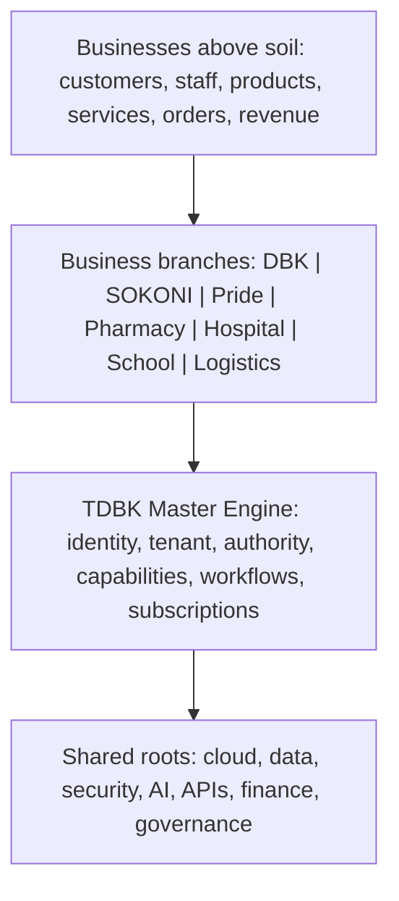

# TDBK End-to-End Junction & Dependency Map
**Audit date:** 2026-11-17  
**Working branch:** `audit/stage-1-master-unification-register`  
**Status:** IN PROGRESS — evidence-backed partial trace, not a production certification.

## Purpose
Trace TDBK as the whole tree: businesses and customers operate above the soil; TDBK provides the shared digital and operational foundation beneath them. The Master Engine is the coordinating trunk, not the whole organisation.

Each junction is assessed across: source/producer, consumer, authority, contract, tenant/security boundary, lifecycle/failure handling, verification evidence and live status.

### Status vocabulary
- **VERIFIED — SOURCE:** the named source file or contract was inspected; this does not prove production execution.
- **PARTIAL:** some implementation or contract evidence exists, but a required boundary or test is incomplete.
- **BLOCKED:** a documented release gate prevents safe activation.
- **UNKNOWN:** source or runtime evidence has not yet been inspected.
- **NOT VERIFIED LIVE:** no authenticated production test was performed in this audit.

## 1. Whole-tree dependency model

The direction of value and control is bidirectional: the foundation supplies capabilities and policy; business operations return events, state and commercial outcomes. A branch remains responsible for its domain operations while consuming shared authority through explicit contracts.

## 2. Junction register

| ID | Junction | Source / consumer | Evidence inspected | Assessment |
|---|---|---|---|---|
| J01 | TDBK authority → Master Engine | Master identity/authority → all platform services | `src/kernel/types.ts` defines Principal, TenantContext, BranchContext, SecurityContext and AuditEvent. DBK contract declares Engine authority over identity, tenancy, DNA, capabilities, entitlements, permissions, transactions, payments, receipts, workflows, events, AI, connectors, audit and security. | **PARTIAL — SOURCE VERIFIED.** Contract authority is clear; complete enforcement across every service and runtime is not verified. |
| J02 | Master Engine → tenant/branch context | Security context → tenant-scoped services | `Principal` carries tenantId, branchId, roles, permissions and tokenSource; `SecurityContext` carries tenant/branch context and request/correlation IDs. | **PARTIAL.** Type contract exists; adversarial cross-tenant and branch-boundary test evidence still required. |
| J03 | Master Engine → connector integrations | Connection Hub → provider bridge adapters | `src/orchestration/bridge/connectionHub.ts` resolves connection records using tenant context, rejects missing tenant context, checks bridge definition and uses Firestore connection repository, RBAC and audit services. | **PARTIAL.** Tenant-aware resolution exists in source; provider credentials, real provider calls and live health are not verified. |
| J04 | Master Engine → workflow/event execution | Workflow Engine → repositories, outbox, event bus, step handlers | `src/orchestration/workflow/engine.ts` creates tenant-bound workflows, correlation IDs, retry policies, compensation references, audit events and lifecycle envelopes. Persistent creation writes workflow/outbox records before publication. | **PARTIAL.** Durable path is present in source; worker delivery, restart recovery, idempotency and production persistence need execution tests. |
| J05 | Master Engine → DBK experience | Experience Projection → workspace manager → DBK UI | `src/platform/projection/experienceProjection.ts` checks master or tenant access, compiles workspace and projects identity, sector, status, subscription tier, branches, capabilities and terminology. `docs/DBK_WEBSITE_EXPERIENCE_CONTRACT.md` says DBK is an experience layer, not a second authority. | **PARTIAL.** Projection and authority contract exist; deployed DBK consumption and public-safe projection are not verified. |
| J06 | Master Engine → subscription/licensing | Subscription router/service → DBK registry, subscription repository, M-Pesa bridge | `src/platform/subscription/subscriptionRouter.ts` creates security context, checks DBK access, initiates M-Pesa STK via Connection Hub and records pending provider reference/status. | **PARTIAL / BLOCKED FOR LIVE ACTIVATION.** Router path exists; provider-confirmed payment-to-ledger activation is gated. |
| J07 | Payment provider → financial truth | Daraja adapter/status query → tenant transaction → ledger | `docs/audits/MPESA_PRODUCTION_CALLBACK_VERIFICATION_GATE_2026-11-14.md` states production callbacks fail closed because callback origin cannot be authenticated; Transaction Status Query and authenticated asynchronous result ingress are not yet implemented. | **BLOCKED.** Do not treat callback payloads or STK initiation as proof of payment. Sandbox/UAT and reconciliation path required. |
| J08 | Business catalogue → SOKONI | Seller/product authority → public listing/discovery | DBK contract says public organisation projection and SOKONI handoff require MASTER REVIEW; it records no concrete public-profile/SOKONI projection contract found at its inspection date. | **UNKNOWN / MASTER REVIEW REQUIRED.** Product/seller authority, publication rules and API/event contract must be traced in SOKONI and branch repositories. |
| J09 | SOKONI → advertising → customer | Approved listing → campaign asset → enquiry/order | No source evidence inspected in this pass for the end-to-end campaign-to-listing-to-conversion contract. | **UNKNOWN.** Must prove ads use approved authoritative product data and track enquiries/orders back to the seller/listing. |
| J10 | Order → inventory → delivery | Order service ↔ stock reservation ↔ fulfilment | No shared cross-branch contract inspected in this pass. | **UNKNOWN.** Need reservation semantics, lifecycle transitions, cancellation/reversal, delivery proof and reconciliation. |
| J11 | AI workforce → staff/control panel | Agent orchestration → duty assignment → execution/audit | Initial baseline ledger records agent runtime, role catalogue, team routing and Firestore execution repositories; deterministic routing metadata is not proof of specialist execution. | **PARTIAL / NOT VERIFIED LIVE.** Inspect durable runs, permissions, approval gates, retry/recovery and staff duty ownership. |
| J12 | Business branch → shared platform | Pride, pharmacy, hospital, school and logistics systems → Engine contracts | Seven repositories were discovered in the baseline register; branch source-to-engine API/event and tenant identity propagation have not yet been fully inspected. | **UNKNOWN by branch.** Do not merge, retire or assume a common backend until domain/data/security/deployment comparisons are complete. |

## 3. Vertical journey traces

### A. Tenant onboarding → operating workspace
1. User authenticates and supplies target business identity.
2. Security context resolves principal, tenant and branch.
3. Master authority/registry validates ownership and tenant access.
4. Business DNA/blueprint and capability eligibility are resolved.
5. Provisioning creates or activates the business workspace.
6. Entitlements/subscription determine enabled capabilities.
7. Experience Projection supplies the DBK client with authoritative workspace state.

**Observed evidence:** kernel context types, DBK authority contract, experience projection, subscription router.  
**Still to prove:** full provisioning sequence, authoritative DNA/blueprint persistence, entitlement enforcement in every capability, cross-tenant denial tests and deployed DBK end-to-end journey.

### B. Seller/product → SOKONI → order → payment
Seller identity → product record → seller-approved publication → SOKONI discovery → advert/campaign → customer enquiry/order → stock reservation → fulfilment → provider-confirmed payment → ledger/receipt → seller reporting.

**Current assessment:** the intended journey is defined, but the catalogue/SOKONI/advertising/order/inventory joints remain **UNKNOWN** in this source pass. Payment settlement is **BLOCKED** for live M-Pesa until provider query/reconciliation is implemented and tested. Do not publish invented prices, specs or stock.

### C. Pride Industries operating journey
Configurable product/variant/price → POS or customer order → stock allocation → delivery/return/container lifecycle → payment verification → ledger/invoice/receipt → management reporting.

**Current assessment:** Pride repository was inventoried previously, but its current source files, storage durability, order lifecycle, WhatsApp and payment integration have not yet been inspected in this junction pass. Mark **UNKNOWN / NOT VERIFIED LIVE** until source and client workflow tests are collected.

### D. Pharmacy operating journey
Tenant/user → medicine catalogue and batch records → prescription/dispensing → FEFO and stock movement → sale/payment → audit/reporting.

**Current assessment:** two pharmacy repositories exist. Canonical ownership, data model, regulatory workflow, FEFO enforcement, tenant isolation and live deployments remain to be compared. No consolidation decision is made.

## 4. Critical invariants at every junction
1. One authoritative owner for each business record; projections and caches are not competing truth.
2. Every tenant-scoped command derives tenant identity from trusted security context, never an untrusted request-body tenant selector.
3. Branch permissions are evaluated independently of tenant membership.
4. Every cross-service event carries tenant, branch (where applicable), event type/version, correlation and causation identity.
5. External side effects use durable outbox/idempotency/retry/compensation patterns where applicable.
6. A payment is not financially true until provider-confirmed and reconciled to the correct tenant, amount, currency and transaction.
7. Customer-facing success is shown only after durable persistence or confirmed provider outcome.
8. A business branch can remain independently deployable without creating a second master identity, entitlement or ledger authority.
9. Production readiness requires deployment, monitoring, backup/restore, security and end-to-end evidence—not source code or README claims alone.

## 5. Priority evidence collection

| Priority | Evidence to collect | Why it matters |
|---|---|---|
| P0 | Tenant/branch adversarial tests; security context creation; Firestore rules | Prevent cross-tenant disclosure or mutation. |
| P0 | M-Pesa Transaction Status Query + authenticated result ingress + ledger reconciliation tests | Prevent forged or misattributed financial settlement. |
| P0 | Pride current persistence/deployment and order-to-delivery client acceptance | Protect active client delivery and data durability. |
| P1 | DBK provisioning, DNA, entitlement and projection end-to-end tests | Prove the trunk provisions and governs branches. |
| P1 | SOKONI seller/catalogue/publication/order contracts | Establish the public commerce branch and its revenue loop. |
| P1 | Workflow outbox worker, restart recovery, retry and compensation tests | Prove reliable orchestration. |
| P1 | Pharmacy repository comparison and domain-specific safety tests | Resolve duplication without losing business logic. |
| P2 | Agent execution persistence, staff duty queue, approvals and audit | Prove governed workforce coordination. |
| P2 | Hosting, DNS, cloud project, backups, monitoring and restore inventory | Establish operational resilience. |

## 6. Evidence boundaries and next work
- This map is based on source files and contracts fetched on 2026-11-17. Source inspection is not a live deployment test.
- The register branch is an audit workspace; no production changes, PR merges, deployments, billing changes or financial actions were performed.
- Continue by inspecting complete source trees and tests for DBK, SOKONI, Pride, pharmacy, hospital, school and logistics; then inspect deployment/cloud evidence and test the critical journeys.
- Update each junction only when the exact source path, contract, tests and runtime evidence are recorded.
- Stage 1 remains **IN PROGRESS**. Freeze only after critical junctions have owners, evidence, status and explicit unknowns.

## 7. Deep trace: Pride Industries (Aquaflow repository, main)

**Repository inspected:** `thuram34/Aquaflow`, default branch `main`, tree SHA `792db417d12c8b10d6dff6f73fbdc6a8464c8d49`. This is source inspection, not a production environment inspection.

### 7.1 Actual runtime and data authority
- `server.ts` starts an Express API under `/api`, serves the Vite SPA and exposes `/api/health`.
- `src/server/api.ts` initializes `Database.getInstance()`; operational routes read and mutate this database.
- `src/server/db.ts` persists the full operational schema as JSON at `AQUAFLOW_DATA_DIR/water_business_db.json` (default production directory `/var/data/aquaflow`). It enforces that the configured data directory is inside `AQUAFLOW_PERSISTENT_ROOT` and refuses startup if persistent storage is not mounted or the database schema is unknown/corrupt.
- The schema includes business config, staff, products, stock receiving/ledger/allocations, customers, sales, credit, containers, deliveries, expenses, audit, QuickBooks queue, M-Pesa transactions, sessions and login attempts.
- `src/lib/firestoreSync.ts` separately writes selected workspace/public-storefront/public-order projections to Firestore. Its existence does **not** make Firestore the authoritative operational database: README, database implementation and client handover explicitly state that the operational app still uses JSON persistence and the Firestore migration is incomplete.

**Junction P01 — Operational UI/API → JSON database:** **SOURCE VERIFIED / DURABILITY ENVIRONMENT UNKNOWN.** The API uses JSON as operational truth. A persistent mount and off-host backup are mandatory. No live mount, backup destination or restore rehearsal was verified in this audit.

### 7.2 Identity, staff and branch authority
- `src/server/security.ts` stores session token hashes and login-throttle hashes in the same JSON database; API routes resolve sessions and permission checks.
- `src/server/branch.ts` enforces branch matching and reconstructs branch stock only from stock-ledger movements attributed to the staff member's branch.
- `src/server/api.ts` applies permission middleware to staff, control-panel, product and other operational routes; business configuration and shared product catalogue changes are restricted to enterprise administrators.
- `src/server/branch.integration.test.ts` and branch unit tests are included in the configured test command; source-level integration tests include cross-branch denial assertions.
- Firestore rules constrain the optional Firestore projection and public ordering collections, but these rules do not replace the Express API's operational authorization boundary.

**Junction P02 — Staff identity → role/branch permissions → operational records:** **PARTIAL.** Branch isolation logic and tests exist. This is an independent Pride staff/branch identity model, not yet proven federated to TDBK Master identity/tenant context. Do not describe it as TDBK-wide SSO or master tenancy.

### 7.3 Catalogue → POS → stock
- The JSON schema stores dynamic categories, packaging types and product records. Product configuration is runtime data, not a fixed catalogue list.
- API routes expose product and stock receiving operations; branch stock is reconstructed from stock ledger movements.
- Control Panel configuration includes branches, payment methods, tax, container and credit rules.
- The current product catalogue is shared across branches and edits require enterprise administrator authority.

**Junction P03 — Configured product → POS/sales → stock ledger:** **PARTIAL / SOURCE PRESENT.** The repository has the relevant models and operational routes. Full sales-to-ledger consistency, concurrent stock mutation, and end-to-end physical stock reconciliation still require test/runtime evidence.

### 7.4 Public ordering → fulfilment
- The public-order integration test explicitly exercises catalogue gating, owner enabling public ordering through Control Panel, branch validation, public order submission, status lookup by order number plus phone, driver assignment, dispatch, delivery and collection.
- The test explicitly asserts that public order submission does **not** deduct stock at order creation. This means order acceptance and stock reservation are separate lifecycle events; do not assume a reservation has happened merely because an order was accepted.
- `src/server/delivery.ts` defines delivery transitions, dispatch stock validation, partial-delivery settlement, container issuance/collection, invoice totals and collection validation.
- `src/server/delivery.integration.test.ts` exercises once-only cash collection, invoice/customer credit reconciliation, duplicate reference handling, over-collection rejection, unverified M-Pesa rejection and cross-branch denial.

**Junction P04 — Public order → stock commitment → delivery:** **PARTIAL.** Public order and delivery lifecycle have meaningful integration tests. The public-order test's no-stock-deduction assertion makes a later explicit allocation/reservation step a required operational control. Need inspect and prove that acceptance/dispatch path cannot oversell under concurrent orders, and verify customer-facing order confirmation and actual delivery evidence in the deployed system.

### 7.5 Payment → reconciliation → ledger
- `src/server/mpesa.ts` implements Daraja token acquisition, STK initiation, callback-token validation, callback normalization and STK transaction query.
- Config requires credentials, a long callback token and HTTPS APP_URL.
- The delivery collection planner deliberately permits Cash or Bank Transfer only and instructs M-Pesa to be reconciled through the Safaricom workflow.
- The test suite includes M-Pesa normalization/query tests and the delivery integration test rejects an unverified M-Pesa collection.
- Source presence and mocked tests are not proof of successful Pride client Daraja credentials, public callback reachability, provider-confirmed settlement or production reconciliation.

**Junction P05 — Daraja → transaction truth → customer balance/invoice:** **PARTIAL / LIVE NOT VERIFIED.** The implementation has a query path, but no Pride production UAT evidence, deployed callback evidence or reconciled live transaction was inspected. Keep live M-Pesa disabled until the actual client's credentials, callback, query-result mapping, duplicate/failure/timeout handling and ledger reconciliation are proven.

### 7.6 Deployment, storage and recovery
- `vercel.json` contains SPA rewrites; `server.ts` requires the Express process for API routes. A static frontend deployment alone is not the complete application runtime.
- `.github/workflows/google-cloud-staging-inventory.yml` inspects a Google Cloud staging project and lists Firestore databases and Firebase Hosting sites. It is an inventory workflow, not evidence that the operational JSON API is deployed or that a production volume is mounted.
- The README and handover explicitly require durable storage, off-host encrypted backups and isolated restore verification. Backup utility tests cover encryption, integrity, schema validation and isolated restore, but do not prove an off-host destination or production recovery.
- Render is not required by the repository. Hosting must support the long-running Express API, persistent storage, HTTPS and private secrets. Firebase Hosting by itself does not supply the JSON database volume or run this Express process.

**Junction P06 — Application runtime → durable data → recovery:** **BLOCKING ACCEPTANCE EVIDENCE.** Source guards are good, but live hosting/provider, mounted volume, off-host backup, restart persistence and restore rehearsal remain unverified. Do not cut over or hand over as production-ready until evidenced.

### 7.7 Client handover scope boundary
`docs/CLIENT_HANDOVER.md` explicitly lists complete supplier/procurement lifecycle, full stock reservation/public-order-to-invoice lifecycle, production M-Pesa checkout/reconciliation, production WhatsApp worker/templates/monitoring, QuickBooks OAuth/sync, complete Firestore migration and complete financial container-deposit ledger/reconciliation as items not to promise without additional implementation and environment testing.

**Pride branch conclusion:** The repository contains a substantial internal operations foundation with staff/branch controls, dynamic catalogue, POS/inventory, public ordering, delivery/credit/container workflows, M-Pesa adapter and backup utilities. It is **not proven production-ready**. The largest immediate risk is the split between operational JSON authority and optional Firestore projections, followed by unverified durable hosting/recovery and incomplete external integration certification.

## 8. Other branch findings from initial source inspection

### Pharmacy: chemist-pro vs TRAIL-PHARMACY
- `chemist-pro` contains a TDBK integration file at `tdbk-integration/chemistPaymentRouter.ts`, Firebase Functions/server entry points, Firestore rules, and an operational release checklist. Its current README states that it is not approved for live pharmacy trading.
- `TRAIL-PHARMACY` contains a broad pharmacy domain model and Firebase-backed service layer. The inspected types include pharmacy/owner identity, members, categories, products, batches, stock movements, purchase orders, goods receipts, supplier invoices/payments, sales, prescriptions, customer receipts and audit records. Product and batch records are scoped by pharmacyId; stock is batch-aware.
- The TRAIL service's initial owner lookup queries top-level `pharmacies` by deterministic ID or ownerUid/email; this is a different identity and tenancy model from the Master Engine's tenant context. Firestore rules and every service method must be examined before deciding isolation is sufficient.
- The two repositories are not yet proven to be duplicates or interoperable. Preserve both pending domain coverage, data migration, regulatory, security, deployment and tenant-isolation comparison.

**Pharmacy junction status:** **UNKNOWN / PARTIAL.** Do not merge repositories or select a canonical implementation yet.

### Hospital: Ugatuzi
- `docs/MULTITENANT_HMIS_ARCHITECTURE.md` describes a target shared platform with facility tenants, tenant-aware identity/membership/RBAC, subscriptions, audit and integration hub. It explicitly requires authenticated tenant context and tenant isolation, and proposes a second-facility acceptance test without cloning a repository.
- This is an architecture contract, not proof that all routes, Firestore rules, clinical workflows or deployments satisfy it. The actual code and CI tests still need to be mapped against the contract.

**Hospital junction status:** **CONTRACT FOUND / IMPLEMENTATION PARTIAL OR UNKNOWN.**

## 9. Updated priority sequence based on source evidence
1. **Pride production truth first:** identify the actual deployed Express host, verify persistent volume and data path, create and verify an off-host encrypted backup, perform an isolated restore, and complete client-accepted internal workflows. Keep M-Pesa/WhatsApp/QuickBooks/public promises gated until their specific tests pass.
2. **Master-to-branch contract:** define the tenant/branch identity handoff for Pride without prematurely replacing its working staff/branch model or duplicating financial truth.
3. **SOKONI commerce contract:** establish authoritative seller/product/publication/order records and explicitly connect the catalogue to fulfilment and payment truth.
4. **Pharmacy comparison:** complete side-by-side feature/security/data/deployment matrix for chemist-pro and TRAIL before any consolidation.
5. **Ugatuzi verification:** map actual tenant context, RBAC, subscription, audit and facility workflows to its architecture contract.
6. **Only then** decide shared modules, migration boundaries and implementation slices.

**Stage 1 remains IN PROGRESS.** The new Pride findings improve source-level traceability but do not certify live deployment, client acceptance, production storage or live payment.

## 10. Deep trace: SOKONI and public discovery boundary

### 10.1 Engine public organization projection
`docs/ENGINE_PUBLIC_DISCOVERY_CONTRACT.md` defines an Engine-owned public-safe organization projection derived from canonical `DbkIdentity` and branch topology. It excludes private/legal/owner/subscription/permission/financial state. It defines public eligibility from DBK lifecycle, but explicitly says **eligibility is not publication state** and no public unauthenticated HTTP/API path is authorized until publication authority exists. It does not establish public product/service/provider masters, marketplace search, service coverage or availability.

### 10.2 SOKONI Phase 1 contract
`docs/sokoni/PHASE1_EXPERIENCE_CONTRACT.md` states SOKONI owns public discovery/marketplace presentation while TDBK Engine owns authoritative identity, tenancy, business/provider/product/service truth, capabilities, workflows, transactions, payments, receipts, events, security and audit. It explicitly distinguishes DBK capability discovery from public marketplace discovery. It identifies public search, product/service/provider projection, requests, quotes, publication and trust as missing or master-review dependencies; it directs SOKONI to reuse existing Engine sale/payment/receipt authority rather than build parallel financial truth.

### 10.3 Current SOKONI status is not the same as Engine integration
`docs/master/SOKONI-STATUS.md` (last updated 2026-09-23) records a participation-first SOKONI implementation with Firestore `sokoniParticipants`, participant media in Firebase Storage, public discovery of persisted ACTIVE participants, and product/service listings containing name, description and media references. It records real payment initiation/confirmation and paid-offering activation as unimplemented; discovery is area-filtered and does not claim proximity, coverage or availability. It also says TDBK relationship is persisted as `NOT_ENROLLED`, with no DBK/Business DNA/entitlement/Engine workflow created.

**Junction S01 — SOKONI participant Firestore → Engine organization/product authority:** **PARTIAL / DOMAIN BOUNDARY UNRESOLVED.** A SOKONI-owned participant dataset exists per status document, while the Engine public contract forbids a second public organization master and expects the canonical DBK identity projection. Need reconcile which entity types are independent marketplace participants versus DBK-registered businesses, and define a one-way governed projection/handoff without duplicating Engine-owned identity or product truth.

**Junction S02 — SOKONI listing → public discovery:** **PARTIAL.** Persisted participant discovery is documented; authoritative product stock/price/availability and transaction-ready listings are not part of the recorded listing model. Do not infer an orderable catalogue from the current product/service listing record.

**Junction S03 — SOKONI discovery → request/quote/order/payment:** **MISSING / NOT IMPLEMENTED PER STATUS.** Real payment initiation/confirmation and request/quote flows require the Engine contract and must not be created as a parallel financial path.

## 11. Deep trace: pharmacy and hospital identity boundaries

### 11.1 Chemist Pro
- The repository contains a TDBK integration payment router and a Cloud Functions/server API direction. Its Firestore rules are globally deny-by-default, stating browser SDK data access is denied and tenant data is accessed through the authenticated Cloud Functions API.
- Its operational release checklist requires backend verification of Firebase ID token, active tenant membership, role/permission and tenant scoping on every endpoint, with cross-tenant denial tests.
- The checklist is an acceptance target, not proof that all functions and tests currently pass. The repository README has previously stated it is not approved for live pharmacy trading.

### 11.2 TRAIL-PHARMACY
- The inspected domain types and service layer use `pharmacyId` for pharmacy, member, product, batch, stock, supplier, purchasing, sale and prescription records.
- Initial owner lookup uses a top-level `pharmacies` collection and ownerUid/email matching. The model is pharmacy-scoped, but no Master Engine tenant identity contract was verified in the inspected source.
- Pharmacy data is richer than the initial Chemist Pro slice in batch expiry, prescription, purchasing and supplier lifecycle vocabulary. This is not enough to conclude it is safer or more complete overall.

**Junction PH01 — Master tenant → pharmacyId/tenantId:** **UNKNOWN / MASTER REVIEW REQUIRED.** Need explicit mapping, trusted identity propagation, server authority, role mapping, audit and migration proof. Do not simply rename `pharmacyId` to `tenantId` without a controlled migration.

### 11.3 Ugatuzi hospital
- The hospital architecture document describes a shared multi-tenant target, but `docs/ACCESS_CONTROL.md` explicitly states the current product is a **single-hospital system** for `ugatuzi-national`, with no second hospital workspace and no hospital switching.
- The inspected Firestore rules globally deny by default and then define role/module helpers, but the helper `isUgatuzi(hospitalId)` and validation functions hardcode `ugatuzi-national`.
- The frontend `TenantProvider` constructs a tenant context from the authenticated hospital/profile, but that client context is not itself a server authorization proof.

**Junction H01 — Multi-tenant target → current Ugatuzi implementation:** **PARTIAL / SINGLE-TENANT IN PRACTICE PER ACCESS CONTRACT.** The architecture target must not be mistaken for a proven multi-hospital deployment. The second-facility acceptance test remains outstanding.

## 12. Current CI and environment evidence snapshot (2026-11-17)
- Pride workflow run [44153835044](https://github.com/thuram34/Aquaflow/actions/runs/44153835044), **AquaFlow quality checks**, completed successfully. Its job steps show dependency installation, TypeScript check, automated regression tests and production frontend build all completed successfully on `main`.
- Pride workflow run [44152962857](https://github.com/thuram34/Aquaflow/actions/runs/44152962857), Google Cloud OIDC authentication check, completed successfully.
- Pride workflow run [44153835617](https://github.com/thuram34/Aquaflow/actions/runs/44153835617), read-only staging resource inventory, was still **in progress** at the time of inspection. Authentication, API inventory and Cloud Run inventory steps had passed; Firebase Hosting site inspection was still running. No resource inventory result is claimed here.
- These CI checks prove source checks and test/build execution on the referenced commits; they do not prove production deployment, durable volume, domain, real payment, off-host backup or client acceptance.

## 13. Cross-branch integration rule
The inspected repositories do not currently demonstrate one common tenant identity implementation:
- Master platform uses `tenantId`, principal/security context and branch context.
- Pride uses local staff sessions, branch identity and JSON operational database.
- TRAIL pharmacy uses `pharmacyId` in its Firestore domain model.
- Ugatuzi currently hardcodes `ugatuzi-national` in access rules and documents itself as single-hospital.
- SOKONI status records a SOKONI-owned participant identity and explicitly `NOT_ENROLLED` TDBK relationship.

Therefore, the next integration layer must be an explicit **identity and domain mapping contract**, not a direct database merge. It must define canonical entity ID, local ID, tenant ID, branch/facility ID, principal/member mapping, role mapping, data ownership, event contract, deprovisioning and migration/rollback. Preserve each branch's working domain until this contract and its adversarial tests exist.
